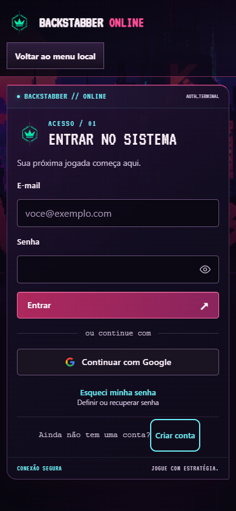

# Backstabber // Auth Terminal

Uma identidade Supabase, acesso por Google ou senha e recuperação por email. O UUID continua sendo a chave do multiplayer.

- [Desenho e plano executado](implementation-plan.md)
- [Resultados, limitações e gate de publicação](validation-report.md)
- [Instalação dos emails e SMTP](email-installation.md)
- [Prévia de confirmação](previews/confirmation.html) · [Prévia de recuperação](previews/recovery.html)
- [Capturas e condições dos ensaios](screenshots/README.md)



## Reproduzir os ensaios locais

Requer PowerShell7, Node24, Docker Engine e Supabase CLI3.1 compatível. Os scripts exigem opt-in explícito, validam loopback e não usam projetos remotos. O primeiro prepara somente Auth/PostgreSQL/Mailpit descartáveis, sem migrations do jogo. O segundo reutiliza a stack para testar o frontend real; somente as APIs de jogo são simuladas nesse ensaio.

```powershell
pwsh -NoProfile -File scripts/test-auth-email-local.ps1 -AllowLocalAuthProof -SupabaseCommand supabase
pwsh -NoProfile -File scripts/test-auth-email-browser.ps1 -AllowLocalAuthBrowserProof -SupabaseCommand supabase
```

O projeto descartável fica em `../work/auth-email-proof`, fora do Git. A saída é filtrada para resultados e status HTTP. Os tokens e emails gerados são locais; ainda assim, não exporte a caixa Mailpit, status JSON ou dados do navegador para relatórios. A configuração Google permanece desabilitada. Para encerrar, confira a ajuda de `supabase stop` na versão instalada e use apenas esse workdir; não utilize `--all`.

Os testes Vitest padrão não criam contas hospedadas e o cenário Playwright real exige `BACKSTABBER_AUTH_EMAIL_BROWSER=auth-email-proof`; o wrapper configura essa variável e encerra seu Vite ao sair. Os scripts de ensaio não devem ser servidos ou executados pelo frontend de produção.
