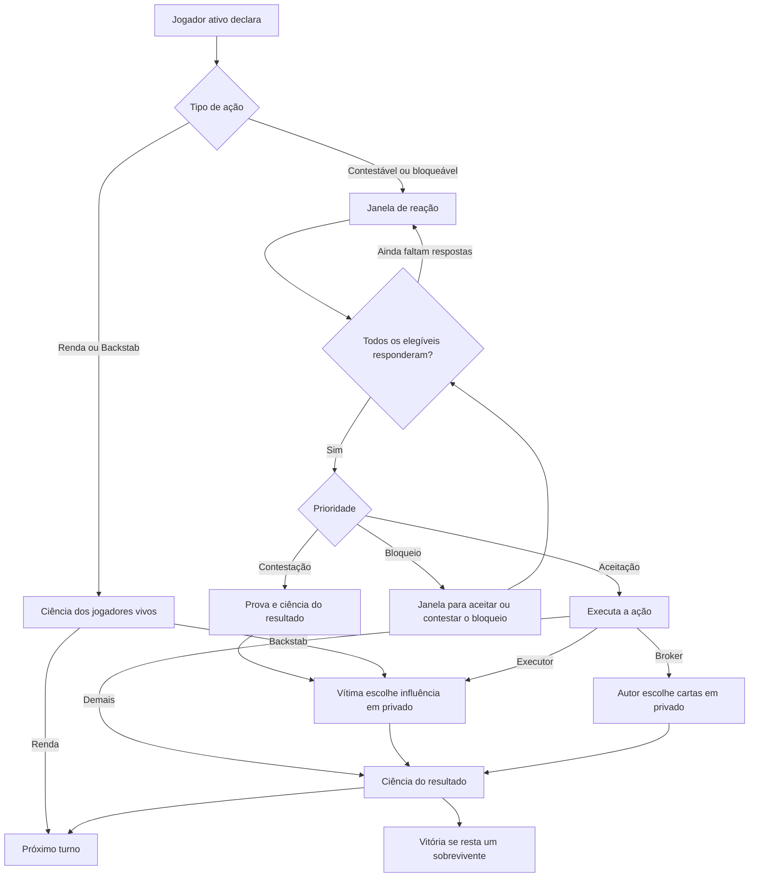

# Fluxo multiplayer

**Dois jogadores.** A declara Backstab em B. A e B confirmam ciência. B escolhe uma influência. Os sobreviventes confirmam o resultado. Se B perdeu sua última carta, A vê a vitória e o anfitrião pode iniciar a revanche.

**Três jogadores.** A declara Magnata. B aceita e C ainda está desconectado. A janela permanece aberta, inclusive após recarga. C retorna, vê a própria mão e responde. Se contestar, a prova é resolvida pelo servidor e o resultado é confirmado antes da perda.

**Quatro jogadores.** A declara Executor contra B. B bloqueia, D contesta e C aceita. A contestação de D tem prioridade apesar de o bloqueio ter chegado primeiro. Se todos aceitarem a ação exceto B, o bloqueio é anunciado e A, C e D votam na janela de bloqueio.

Cada voto confirmado recebe uma sequência inteira na transação. A janela fecha quando o conjunto de respostas cobre todos os elegíveis. A primeira contestação válida vence. Sem contestação, vence o primeiro bloqueio válido. A janela resolvida registra a escolha prioritária para auditoria. Antes disso, o snapshot divulga somente elegibilidade e confirmação de presença do voto.
